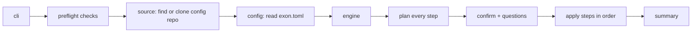

# Architecture

How the code is organised, for people working on exon.

## The flow

## Packages

All code is under `internal/`, so nothing is a public API.

| Package | Job |
|---|---|
| `cli` | The `exon` command and its flags; wires everything together |
| `preflight` | Checks the Mac before anything runs |
| `source` | Turns `owner/repo` or a path into a folder on disk |
| `config` | Reads `exon.toml`; gives each step its own section |
| `engine` | Runs the steps and owns the failure rules |
| `step` | What a step is (`Step`, `Plan`, `Env`) |
| `step/apps`, `step/configs`, `step/git`, `step/ssh`, `step/tmux` | The steps (the checklist is printed by `ui/`, it's not a step) |
| `step/all` | The list of steps, in run order |
| `sys` | The only code that runs commands or writes files |
| `events`, `ui/plain` | Progress messages and how they're printed |
| `prompt` | Asking the user questions |
| `usererr` | Errors meant for the user: a message plus a hint |

## Steps

A step has two phases:

1. **`Prepare`** looks at the system and returns a `Plan`: what it would do. It must not change anything.
2. **`Plan.Apply`** makes the changes.

Steps only touch the system through `step.Env`:

| Field | Use |
|---|---|
| `Run.Query` | Run a command that only reads (`brew info`) |
| `Run.Exec` | Run a command that changes things (`brew install`) |
| `FS` | Read and write files (writes are atomic) |
| `Report` | Progress: `Start`, `Done`, `Skip`, `Fail`, `Notice` |
| `Config` | This step's section of `exon.toml` |

**Planning can't change anything.** The engine gives `Prepare` a read-only `Run` and `FS`. Any write there fails, and a failed plan stops the whole run before changes are made. A dry run simply never calls `Apply`.

**Steps never print.** They report through `env.Report`; the renderer in `ui/` decides what the user sees.

## Failure rules

| What fails | What happens |
|---|---|
| A check | Stop, nothing changed |
| Any step's plan | Stop, nothing changed |
| One item (one app, one file) | Reported; the step carries on |
| A whole step | Reported; the next steps still run |
| A crash inside a step | Caught, reported as that step's failure |
| Ctrl+C | The current command is asked to stop; remaining steps are skipped |

## Adding a step

1. Create `internal/step/<name>/` with a type that implements `step.Step`.
2. Read its settings with `env.Config.Decode(&cfg)` into a struct with `toml` tags.
3. In `Prepare`, inspect and return plan items: `Add`, `Change`, `Same`, `Conflict`, `Warn`, `Note`.
   Return questions from the plan if you need answers.
4. In `Apply`, call `env.Report.Start` / `Done` / `Skip` / `Fail` for each item.
   Use `usererr.New(msg, hint, err)` for errors the user should read.
5. Add it to `internal/step/all/all.go`, in the right place in the order.
6. Test it: `systest.Fake` for commands, `steptest.Env` for files in temp folders.
7. Document it in [how-it-works.md](how-it-works.md) and [configuration.md](configuration.md).

`internal/step/configs` is the simplest example to copy.
