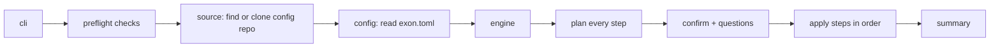
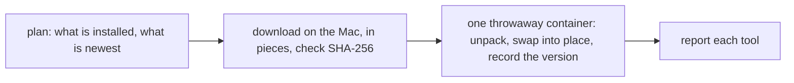

# Architecture

How the code is organised, for people working on exon.

## The flow

## Packages

All code is under `internal/`, so nothing is a public API.

| Package | Job |
|---|---|
| `cli` | The `exon` command and its flags; wires everything together. Commands start from `begin` (log and display) and, if they use a config repo, `loadConfig` (checks, fetch) |
| `preflight` | Checks the Mac before anything runs |
| `source` | Turns `owner/repo` or a path into a folder on disk |
| `config` | Reads `exon.toml`; gives each step its own section |
| `engine` | Runs the steps and owns the failure rules |
| `step` | What a step is (`Step`, `Plan`, `Env`) |
| `step/apps`, `step/configs`, `step/git`, `step/ssh`, `step/tmux` | The Mac setup steps (the checklist is printed by `ui/`, it's not a step) |
| `step/all` | The steps of `exon setup`, in run order |
| `dev/…`, `step/toolbox`, `step/projectinit`, `step/toolboxbackup` | The dev containers part, [below](#the-dev-part) |
| `sys` | The only code that runs commands, writes files or uses the network |
| `events`, `ui/plain` | Progress messages and how they're printed |
| `prompt` | Asking the user questions |
| `usererr` | Errors meant for the user: a message plus a hint |

## Steps

A step has two phases:

1. **`Prepare`** looks at the system and returns a `Plan`: what it would do. It must not change anything.
2. **`Plan.Apply`** makes the changes.

Steps only touch the system through `step.Env`:

| Field | Use |
|---|---|
| `Run.Query` | Run a command that only reads (`brew info`) |
| `Run.Exec` | Run a command that changes things (`brew install`) |
| `FS` | Read and write files (writes are atomic) |
| `Net` | Look up release data (`Get`) and download files (`Download`, in pieces, with a checksum) |
| `CacheDir` | exon's folder for downloads that are safe to delete (`~/.cache/exon`) |
| `Report` | Progress: `Start`, `Done`, `Skip`, `Fail`, `Notice` |
| `Config` | This step's section of `exon.toml` |

**Planning can't change anything.** The engine gives `Prepare` a read-only `Run`, `FS` and `Net`. Any write there fails (`Net` can look things up with `Get`, but `Download` fails), and a failed plan stops the whole run before changes are made. A dry run simply never calls `Apply`.

**Steps never print.** They report through `env.Report`; the renderer in `ui/` decides what the user sees.

## Failure rules

| What fails | What happens |
|---|---|
| A check | Stop, nothing changed |
| Any step's plan | Stop, nothing changed |
| One item (one app, one file) | Reported; the step carries on |
| A whole step | Reported; the next steps still run |
| A crash inside a step | Caught, reported as that step's failure |
| Ctrl+C | The current command is asked to stop; remaining steps are skipped |

## Adding a step

1. Create `internal/step/<name>/` with a type that implements `step.Step`.
2. Read its settings with `env.Config.Decode(&cfg)` into a struct with `toml` tags.
3. In `Prepare`, inspect and return plan items: `Add`, `Change`, `Same`, `Conflict`, `Warn`, `Note`.
   Return questions from the plan if you need answers.
4. In `Apply`, call `env.Report.Start` / `Done` / `Skip` / `Fail` for each item.
   Use `usererr.New(msg, hint, err)` for errors the user should read.
5. Add it to `internal/step/all/all.go`, in the right place in the order.
6. Test it: `systest.Fake` for commands, `steptest.Env` for files in temp folders.
7. Document it in [how-it-works.md](how-it-works.md) and [configuration.md](configuration.md).

`internal/step/configs` is the simplest example to copy.

## The dev part

`exon dev …` runs steps in the same engine, so it has the same plan, confirm and report flow. Its steps
(`step/toolbox` for `install` and `update`, `step/projectinit`, `step/toolboxbackup`) are built by the
commands in `cli/dev.go`, not listed in `step/all`, because they take arguments. `init`, `backup`
and `restore` need no config repo, so those commands skip the checks and the fetch.

| Package | Job |
|---|---|
| `dev/tool` | Each tool as data: how to download it, and which folders hold its logins |
| `dev/release` | The newest or a chosen version of a tool: tag, address and checksum, from GitHub's release data |
| `dev/volume` | Everything done to the Docker volume, through the `docker` command |
| `dev/volume/container/` | The shell scripts that run inside dev containers (`init`, `link-workspaces`), embedded in exon |
| `dev/project` | The templates for a project's personal dev container files |
| `dev/backup` | What a backup holds, its file name, and the check that a file is safe to restore |
| `dev/settings` | Reads `[dev]` from `exon.toml` |

Installing works like this:

- **Downloads happen in Go on the Mac** (`sys.Downloader`), several connections at once, because
  GitHub limits each connection. The container only unpacks, and runs git (so git never runs on the Mac).
- **The container is a throwaway** from a Debian image that has git and tar. It mounts the volume,
  a staging folder under `~/.cache/exon`, and the config repo's `toolbox/` folder.
- **Planning never creates the volume.** Mounting a volume that doesn't exist creates it, so every
  read first asks `Exists`. `Apply` builds its own `volume.Volume` from its own `Env`; the one made
  while planning can only read.
- **The container scripts carry a fingerprint.** It is recorded in the volume, and `exon dev install`
  refreshes the scripts when it changes, so a better script in a new exon reaches the volume.

## Adding a tool

1. Create `internal/dev/tool/<name>.go` returning a `Tool`: its kind (`Program`, `Archive` or
   `Clone`), its GitHub repo, the release file names for Linux arm64 (`Asset`, `Member`) and
   `Links` for the folders that hold its logins.
2. Add it to `All()` in `tool.go`, in install order.
3. Add its real file names to `TestAssetNames`, checked against the release.
4. Add it to the tool lists in [configuration.md](configuration.md) and [dev-containers.md](dev-containers.md).

The plan, the install script and `init` work from the `Tool` data, so they need no change.
