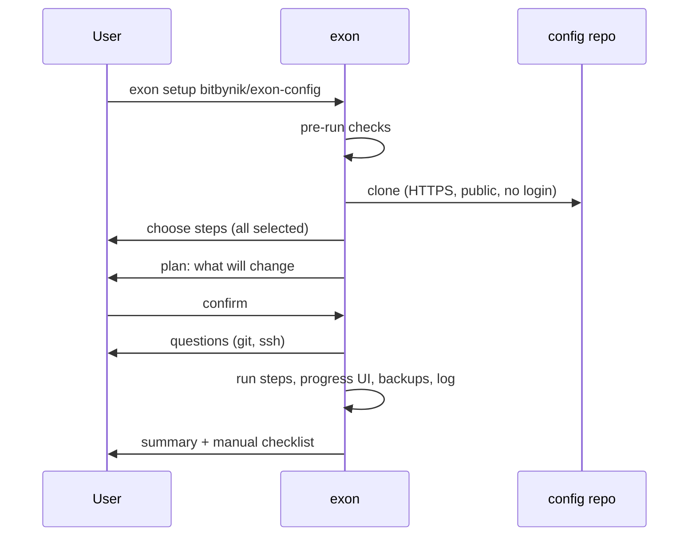
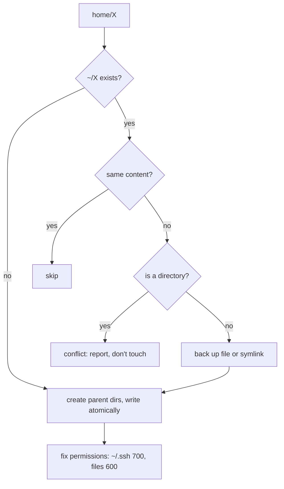
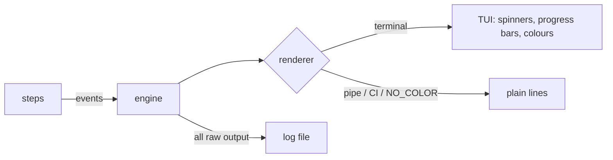

# exon: design

Status: agreed design, before implementation. Changes to these decisions go in `docs/decisions/`.

## 1. Purpose

exon sets up a **freshly reset Mac** from a config repo, in one run:

1. install the user's Homebrew packages, apps and fonts
2. copy their config files into place
3. ask for personal values (git identity, SSH hosts) and write them in
4. install extras (tmux plugin manager)
5. print a checklist of manual sign-ins

After that the configs belong to the user. exon does **not** sync, track or update configs over time.
To change what the next reset gets, the user edits their config repo.

The name is deliberately not tied to one feature: more steps can be added later
(devcontainer support, Linux) without renaming.

## 2. Scope

### In scope (v0.x)

| Area | Decision |
|---|---|
| Platform | macOS on Apple Silicon only (`darwin/arm64`, Homebrew at `/opt/homebrew`) |
| Requirement | Homebrew already installed. Its installer also installs the Xcode Command Line Tools, which provide git |
| Distribution | `brew install bitbynik/tap/exon` (own tap, published by GoReleaser) |
| Config source | A git repo (`owner/repo`, cloned over HTTPS) or a local folder |
| File handling | Whole-file copies. No symlinks, no editing values inside shared files |
| Personal values | Asked at run time, written straight into the final files. Never stored in the config repo |

### Explicitly out of scope

- Logins, tokens, keys, any credential. exon never reads, writes or forwards them
- macOS system settings (`defaults write`): judged not worth the fragility
- GUI app settings
- Ongoing sync (`status`, `save`, `update`, `undo`)
- Intel Macs
- Devcontainers (separate future feature)

## 3. User flow

```sh
# 1. Official Homebrew installer (also installs Xcode CLT + git)
/bin/bash -c "$(curl -fsSL https://raw.githubusercontent.com/Homebrew/install/HEAD/install.sh)"

# 2. Install exon
brew install bitbynik/tap/exon

# 3. Run it
exon setup bitbynik/exon-config
```



## 4. Commands

```
exon setup SOURCE [STEP...] [flags]
exon version
```

| Example | Effect |
|---|---|
| `exon setup bitbynik/exon-config` | Clone, pick steps (all selected), plan, confirm, run |
| `exon setup ~/Projects/exon-config` | Use a local folder (development, offline) |
| `exon setup SOURCE apps configs` | Only these steps |
| `exon setup SOURCE --dry-run` | Checks + plan, then stop. Nothing changes |
| `exon setup SOURCE configs --dry-run --diff` | Plan plus line-by-line diffs of files that would be replaced |
| `exon setup SOURCE --yes` | No confirmation; questions take their defaults (adopt existing apps) |
| `exon setup SOURCE --verbose` | Stream raw command output in addition to the UI |

Steps always run in a fixed order, whatever order they are typed in:
`apps → configs → git → ssh → extras → checklist`.

Cloned repos live in `~/.local/share/exon/repos/<owner>/<repo>`; a rerun pulls the latest commit.
A dry run with a GitHub source clones into a temporary folder that is deleted afterwards.

## 5. Config repo

```
exon-config/
├── exon.toml
└── home/                       mirrors ~ : home/X is copied to ~/X
    ├── .zshrc
    ├── .wezterm.lua
    ├── .tmux.conf
    ├── .gitconfig
    ├── .ssh/config
    ├── .omp/agent/config.yml
    └── .config/starship.toml
```

### `exon.toml`

Each step reads only its own section.

```toml
[apps]
taps     = ["migsilva89/imark"]
formulae = ["bash", "eza", "gh", "git", "mole", "omp", "starship", "tmux",
            "zoxide", "zsh-autosuggestions", "zsh-syntax-highlighting"]
casks    = ["1password", "betterdisplay", "blip", "chatgpt", "claude",
            "google-chrome", "iina", "migsilva89/imark/imark",
            "keyboardcleantool", "obsidian", "orbstack", "raspberry-pi-imager",
            "spotify", "tailscale-app", "telegram", "wezterm", "whatsapp", "zed",
            "font-jetbrains-mono", "font-meslo-lg-nerd-font"]

[configs]
source = "home"

[git]
ask = ["name", "email"]

[ssh]
ask_hosts = true
onepassword_agent = "ask"   # ask | yes | no

[extras]
tpm = true

[checklist]
items = [
  "gh auth login --web --git-protocol https && gh auth setup-git",
  "1Password → Settings → Developer → turn on the SSH agent",
  "omp → /login",
]
```

### Config files for the author's setup

| Tool | File | Notes |
|---|---|---|
| zsh | `~/.zshrc` | Starship prompt; 1Password socket line only takes effect if the socket exists |
| Starship | `~/.config/starship.toml` | Gruvbox Rainbow preset |
| WezTerm | `~/.wezterm.lua` | |
| tmux | `~/.tmux.conf` | Plugins via tpm (installed by `extras`) |
| omp | `~/.omp/agent/config.yml` | Look only: `theme.dark`, `symbolPreset`, `composer.shape`. Nothing else in `~/.omp` |
| git | `~/.gitconfig` | Shared defaults; name/email added by the `git` step |
| ssh | `~/.ssh/config` | OrbStack include; hosts and 1Password agent added by the `ssh` step |

Not shipped: `.zprofile` (written by Homebrew's instructions and OrbStack), gh config (identical to gh's defaults), powerlevel10k.

## 6. Steps

### Pre-run checks (always, before any step)

| Check | On failure |
|---|---|
| Apple Silicon | Stop: "Apple Silicon only" |
| Not running as root | Stop: Homebrew refuses root, files would be owned by root |
| Homebrew on PATH | Stop, print the official install command |
| `brew shellenv` line in `~/.zprofile` | Warn and print the line to add (exon doesn't edit `.zprofile`) |
| Internet reachable | Stop before installing anything (skipped for `--dry-run` with a local source) |
| Free disk space | Warn below 10 GB, let the user continue |
| Real terminal | If not: plain output; questions need flags, otherwise fail clearly |
| `exon.toml` valid | Stop with file, line and the problem |

### `apps`

Plan: `brew update` once, then check every tap, formula and cask. Install what's missing, one package at a time (per-item progress and isolated failures).

| Case | Handling |
|---|---|
| Already installed | Skip |
| Unknown or misspelled name | Fail the plan before installing anything |
| Deprecated/disabled package | Warn in the plan |
| Third-party tap | Marked as third-party in the plan |
| App already in `/Applications` but not from brew | Ask: adopt (`--cask --adopt`), skip, or reinstall |
| Installer needs admin rights | Listed in the plan; UI pauses while brew's own password prompt is shown. exon never handles the password |
| Another brew process running | Wait and retry, then fail clearly |
| Network error | Retry 3× with backoff, then fail that item |

### `configs`

For each file under `home/`:



Plan markers: `+ new`, `~ replace (backup)`, `= same`, `! conflict`.

Replacing `~/.gitconfig` or `~/.ssh/config` removes values written by earlier `git`/`ssh` runs.
When `configs` replaces either file, the matching step is scheduled automatically and its questions
default to the values found in the backup.

### `git`

Asks name and email (validated; current values as defaults), then runs `git config --global user.name/user.email`.

### `ssh`

1. `Use the 1Password SSH agent? [Y/n]`: if yes, adds `IdentityAgent` for `Host *` to `~/.ssh/config`. Warns if 1Password isn't installed.
2. Loop `Add an SSH host?`: alias, host name, user, port (default 22). Validates; an existing alias asks replace/skip.
3. Appends `Host` blocks to `~/.ssh/config`, fixes permissions.

### `extras`

Clones tpm into `~/.tmux/plugins/tpm` if missing. Requires `tmux`; skipped with a reason if it isn't installed. Plugins install on the first tmux start with `prefix + I`.

### `checklist`

Prints the manual items from `exon.toml`. Changes nothing.

## 7. Dry run

`--dry-run` runs the pre-run checks and every step's plan, prints it, and stops.

- Runs: read-only commands (`brew info`, `brew list`), file reads and comparisons.
- Never runs: installs, writes, backups, `brew update`, questions (questions appear in the plan as "will ask").
- Exit codes: `0` plan fine, `1` plan has problems, `2` pre-run checks failed.

Guaranteed by construction: in a dry run `Apply` is never called, and `Prepare` always receives a
read-only `Env.Run`/`Env.FS` whose changing methods fail with `sys.ErrReadOnly`. A step that tries to
change something while planning fails its plan, and an engine test checks exactly that.

## 8. Failures

| Level | Rule |
|---|---|
| Pre-run check | Stop before any change; say how to fix it |
| One item (one package, one file) | Record, continue with the rest, report in the summary |
| Whole step | Continue with other steps unless one depends on it (skipped with the reason) |
| Ctrl+C | Finish or cleanly stop the current item, never leave a half-written file, print a summary |
| Unexpected crash | Recover, write details to the log, show a short message and the log path |

- Exit codes: `0` success, `1` finished with failures, `2` pre-run checks failed, `130` cancelled.
- Retries only for network errors (3×, backoff). Everything else fails immediately.
- Files are written atomically: temp file in the same folder, then rename.
- Non-interactive runs: without a terminal, `--yes` is required and answers every question with its
  default; otherwise exon stops with "run it in a terminal, or pass --yes". Per-question flags
  (`--git-name`, `--git-email`) arrive with the `git`/`ssh` steps.

## 9. Output and UI

The engine emits events; a renderer draws them.



- Progress bars count items (`14/30`); each item shows its phase (downloading, installing) with a spinner.
  Byte-level download percentages are not reliably available from brew, so none are faked.
- Raw command output never reaches the screen unless an item fails (last lines shown) or `--verbose` is set.
- Logs: `~/.local/state/exon/logs/<timestamp>.log`, the last 10 kept.
- Backups: `~/.local/state/exon/backups/<timestamp>/`, mirroring the original paths.

Example run:

```
 apps  ━━━━━━━━━━━━━━━━━━━━━━╺━━━━━━━━━━━━━  14/30  2m 41s

   ✓ git                    0.8s
   ↷ gh                     already installed
   ✗ blip                   download failed (retried 3×)
   ⠼ zed                    downloading…
   · orbstack
```

## 10. Architecture

### Package layout

```
cmd/exon/main.go           entry point
internal/
  cli/                     cobra commands: setup, version
  engine/                  order, failure rules, Ctrl+C, dry run
  step/
    step.go                Step / Plan interfaces, Reporter
    all/                   ordered list of steps (one line per step)
    apps/ configs/ git/ ssh/ extras/ checklist/
    steptest/              test helpers: Env in temp folders, event recorder
  preflight/               pre-run checks
  source/                  resolve SOURCE: clone/pull repo or local folder
  config/                  load + validate exon.toml (line-numbered errors)
  prompt/                  question forms (huh)
  events/                  event types
  ui/tui/  ui/plain/       renderers
  sys/                     Runner, FS, atomic writes, retries
  logfile/                 log file + rotation
examples/starter/          sample config repo for new users
```

Everything is under `internal/`: no public Go API to keep stable.

### Interfaces

```go
// Step is one setup step, e.g. "apps". (internal/step)
type Step interface {
    Name() string
    Summary() string
    Requires() []string                                // commands needed when applying
    Prepare(ctx context.Context, env Env) (Plan, error) // gets a read-only Env
}

// Plan is what a step would do. Building and showing it changes nothing.
type Plan interface {
    Items() []PlanItem
    Questions() []prompt.Question
    Apply(ctx context.Context, env Env, answers prompt.Answers) error
}

// Env is everything a step may touch. Steps never call os/exec or write via os directly.
type Env struct {
    Run       sys.Runner     // Query (read) / Exec (change) / LookPath
    FS        sys.FS         // reads + atomic writes
    Report    *Reporter      // progress events: Start, Done, Skip, Fail, Notice
    Log       *slog.Logger
    Config    config.Section // this step's [section]
    Repo      string         // config repo root
    Home      string
    BackupDir string         // this run's backup folder
}

// Error is shown to the user; Err goes to the log. (internal/usererr)
type Error struct {
    Msg  string
    Hint string
    Err  error
}
```

Adding a feature: a new folder under `internal/step/`, one line in `step/all`, its section in the
config docs. The engine, CLI and UI do not change.

### Dependencies

| Need | Library |
|---|---|
| CLI | `spf13/cobra` |
| TUI | `charmbracelet/bubbletea`, `bubbles`, `lipgloss` |
| Forms | `charmbracelet/huh` |
| TOML | `pelletier/go-toml/v2` |
| Logging | `log/slog` (standard library) |

## 11. Quality and releases

| Area | Rule |
|---|---|
| Format | `gofumpt` |
| Lint | `golangci-lint`, required in CI |
| Tests | `go test -race ./...`; steps run against `sys/systest.Fake` (commands) and real temp folders (files); every edge case in §6 and §8 has a test |
| CI | GitHub Actions, Apple Silicon macOS runner: lint, test, build, dry run of `examples/starter` |
| Release | Tag `vX.Y.Z` → GoReleaser: arm64 binary, checksums, changelog, formula pushed to `bitbynik/homebrew-tap` |
| Commits | Conventional Commits (`feat:`, `fix:`, `docs:`) |

### Development environment

Development happens in the devcontainer. `.devcontainer/Dockerfile` bakes the tools into the image
at pinned versions (into `/go/bin`, replacing the base image's unpinned copies); the image is cached,
so new containers start with every tool ready and the Mac needs no Go install. GoReleaser runs in CI
only (GitHub Action), so its Go version requirement never blocks the container.

| Tool | Used by |
|---|---|
| `gofumpt`, `golangci-lint` | `make fmt`, `make lint` |
| `gopls` | Language server: navigation, diagnostics, formatting (gofumpt) |
| `golangci-lint-langserver` | Lint findings as editor/agent diagnostics |
| `dlv` | Debugger (DAP). The container gets `SYS_PTRACE` + `seccomp=unconfined`, which delve needs |

Coding agents read these files when started from the repo root:

| File | Purpose |
|---|---|
| `AGENTS.md` | Project context and rules. Root location is the cross-tool convention (omp, Codex, Cursor, Copilot…) |
| `.omp/lsp.json` | omp: gopls with gofumpt; golangci-lint server as a linter (diagnostics only, never used for navigation or formatting) |
| `.omp/config.yml` | omp: format on write, diagnostics after each edit |

Delve needs no `.omp/dap.json`: omp's built-in `dlv` adapter is used once `dlv` is on `PATH`.

| Task | Where |
|---|---|
| Edit, `make test`, `make lint`, debugging tests | Container (Linux) |
| `make build` → `bin/exon` (darwin/arm64, cgo off) | Container; the folder is shared with the Mac |
| Run `bin/exon setup … --dry-run` or for real | Mac terminal |
| End-to-end on a real Mac | CI macOS runner |

Rule that keeps this working: macOS-specific checks (architecture, disk space, root) go through
the `preflight.Host` interface, so every package compiles and tests on Linux.

## 12. Docs

| File | Content |
|---|---|
| `README.md` | What it does, demo recording (`vhs`), quick start |
| `docs/getting-started.md` | Fresh Mac to done, including making a config repo from the starter |
| `docs/configuration.md` | `exon.toml` reference, `home/` rules |
| `docs/steps.md` | Each step, its questions and edge cases |
| `docs/safety.md` | Dry run, backups, logs, what exon never touches |
| `docs/troubleshooting.md` | Common failures, logs, exit codes |
| `docs/architecture.md` | §10 in depth |
| `docs/adding-a-step.md` | Contributor walk-through |
| `docs/decisions/` | One short record per key decision |
| `CONTRIBUTING.md`, `SECURITY.md`, `CHANGELOG.md` | Usual |

## 13. Repositories

| Repo | Purpose |
|---|---|
| `bitbynik/exon` | The tool: code, docs, `examples/starter/`. MIT |
| `bitbynik/exon-config` | The author's own setup |
| `bitbynik/homebrew-tap` | Created at the first release; written by GoReleaser only |

## 14. Milestones

| Version | Delivers |
|---|---|
| v0.1 | Engine (plan, dry run, failure rules, events, log), pre-run checks, source resolution, plain renderer, `apps`, `configs` |
| v0.2 | TUI renderer, `git`, `ssh`, `extras`, `checklist`, `--diff` |
| v0.3 | Starter example, full docs, CI, GoReleaser + tap, first public release |
| later | Devcontainer support, Linux |
